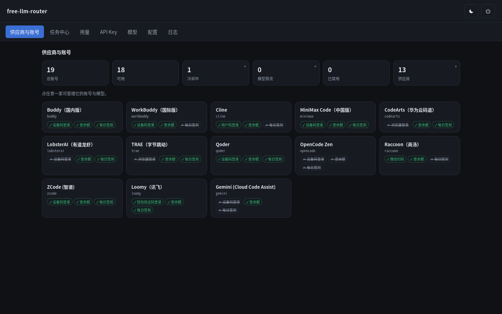
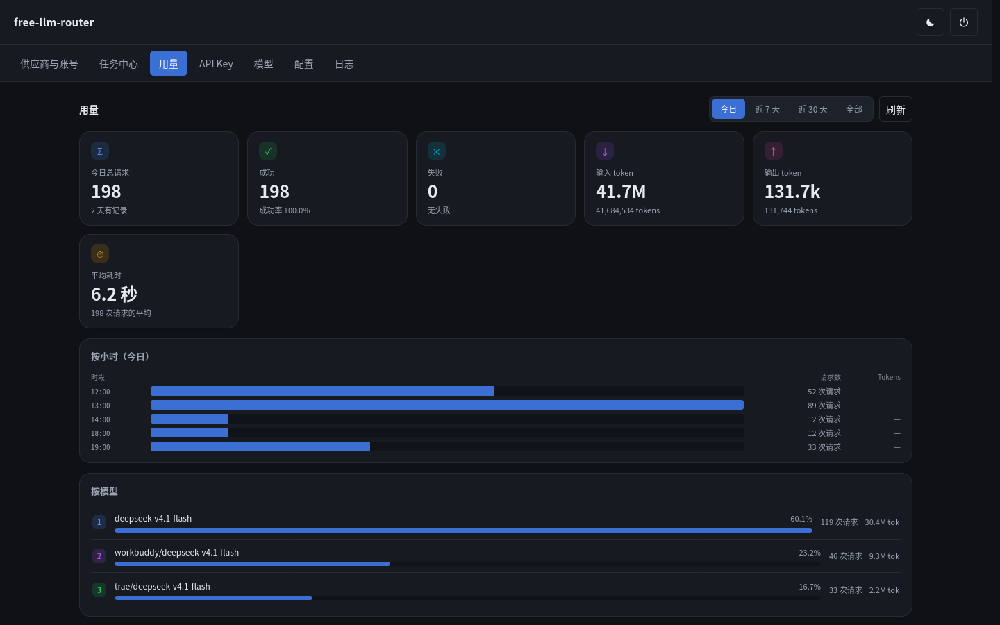
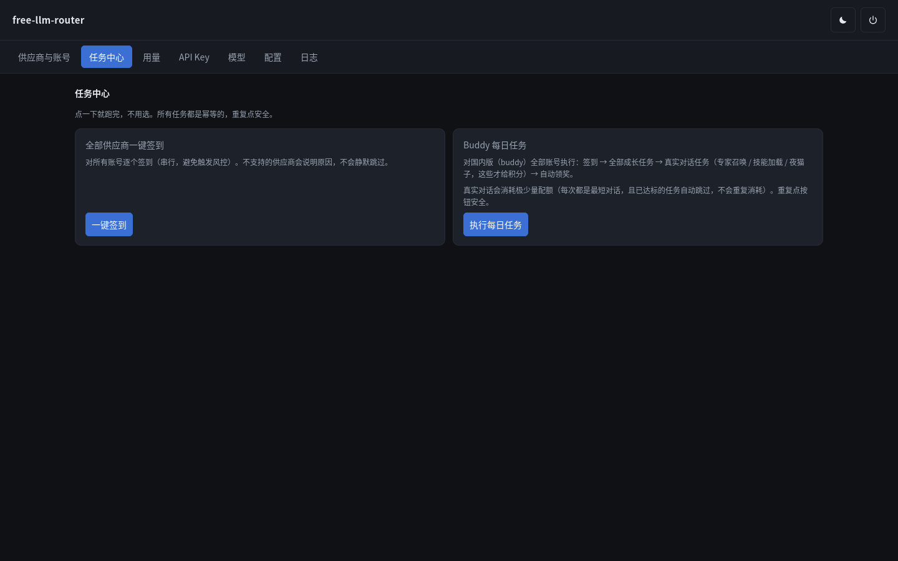
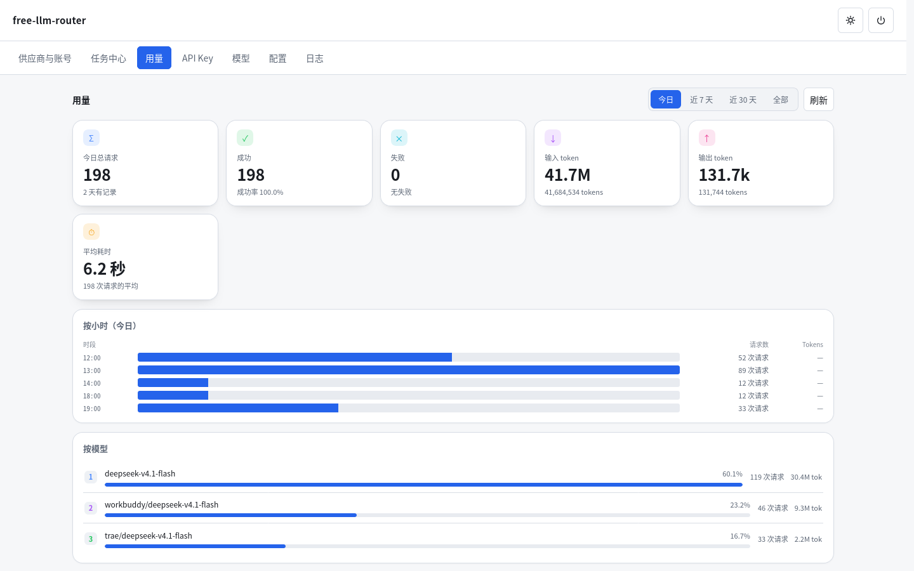
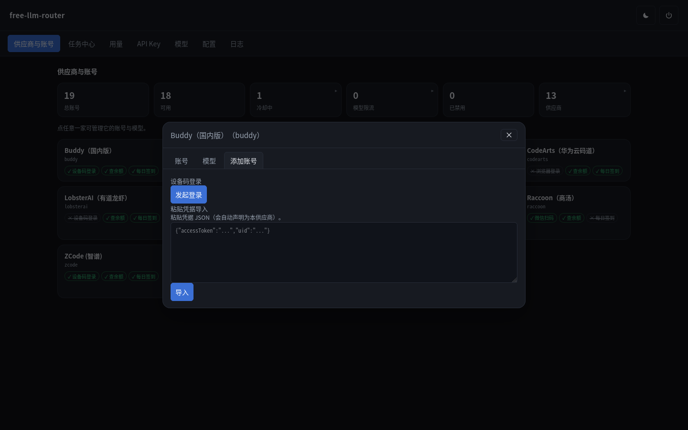
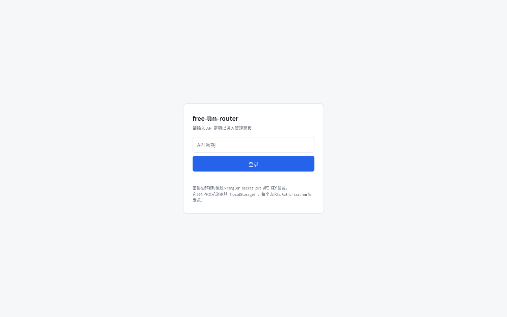
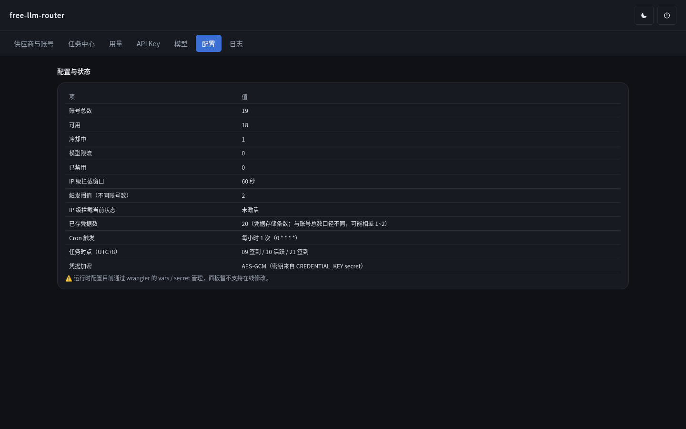
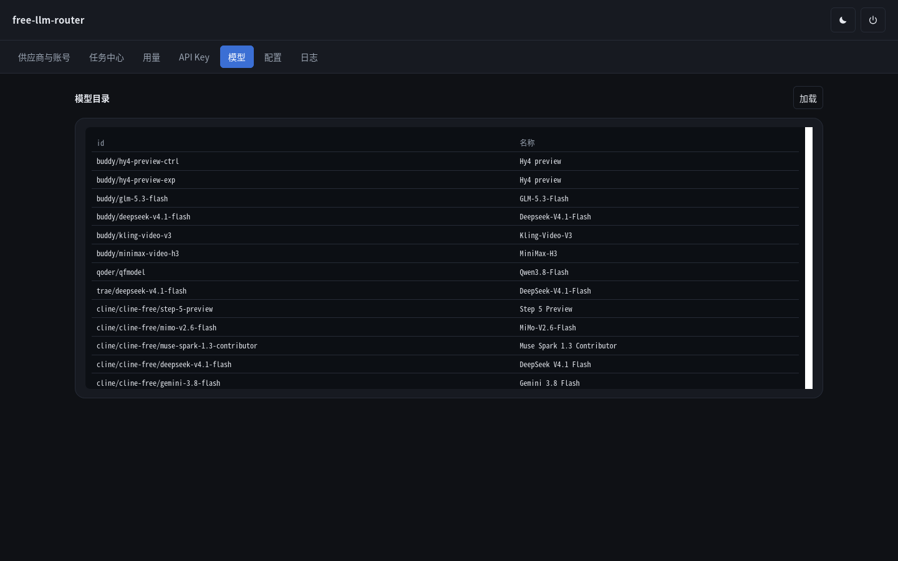
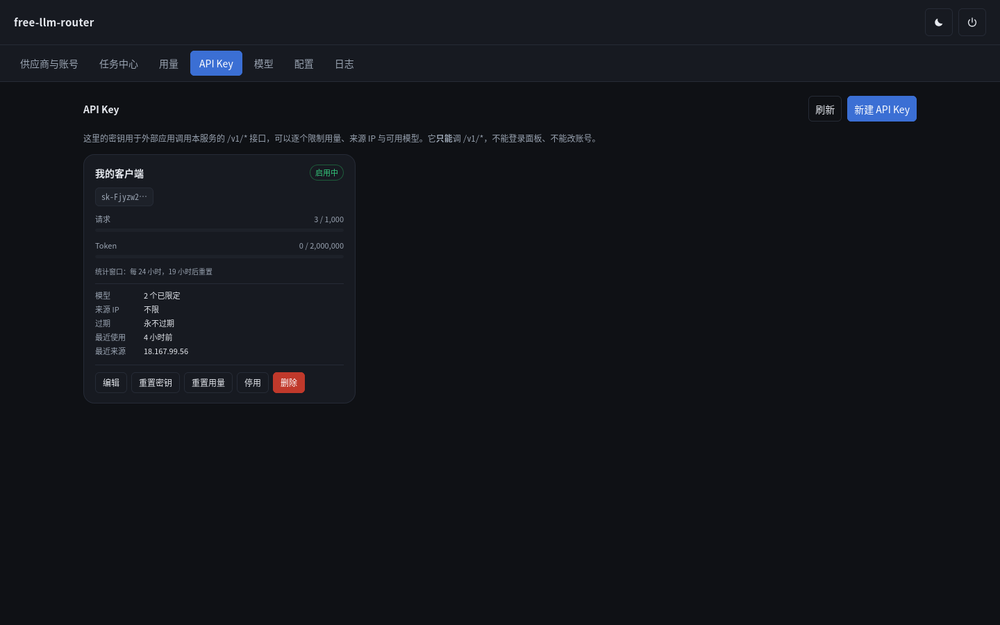
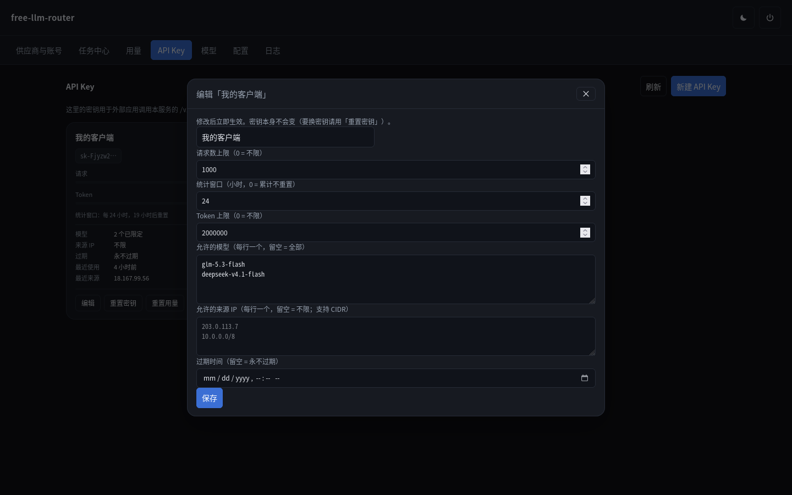

# free-llm-router

把多个大模型供应商的账号池，聚合成**一个 OpenAI 兼容的 API**，外加任务自动化
（签到 / 成长任务 / 自动领奖）。跑在 **Cloudflare Workers** 上，**Free 计划即可**。

- **API 基址**：`https://<你的域名>/v1`
- **管理面板**：`https://<你的域名>/panel/`



---

## 功能

- **OpenAI 兼容网关** —— `GET /v1/models`、`POST /v1/chat/completions`，流式与非流式，
  含工具调用。请求会经过账号池（选号 / 记账 / 失败换号 / 会话粘性）。
- **Responses API** —— `POST /v1/responses`，给 Codex CLI 这类只发 `input` 的客户端用。
  内部复用 Chat 路径，所以 Chat 侧修好的缺陷它自动受益。
- **13 家供应商** —— 统一 `Provider` 接口，模型名用 `provider/model` 前缀路由。
- **聚合路由** —— `aggregate/…` 把各家的**同一个真实模型**归到一个规范名下，
  按「积分最快作废」自动选渠道，失败自动换下一家。
- **子密钥（API Key）** —— 可签发给外部客户端的受限密钥：逐把限制用量、来源 IP 与
  可用模型，且**只能调 `/v1/*`**，不能登录面板、不能改账号。
- **任务自动化** —— 一键签到 + 成长任务 + 自动领奖。真实账号实测过 growth 计划
  **23/23 步全成功**。
- **凭据自动续期** —— 8 家支持。每小时 cron 在**过期前 1 小时**主动换新，
  401 时另有兜底续期重放。
- **凭据加密** —— AES-GCM 落 Durable Object SQLite，不落明文；未配置密钥时拒绝写入。
- **用量统计** —— 今日 / 近 7 天 / 近 30 天 / 全部，含按天趋势、按模型、按账号。
- **管理面板** —— 7 个视图：供应商与账号 / 任务中心 / 用量 / API Key / 模型 / 配置 / 日志。
  深浅双主题，移动端可用。

用量页（今日窗口，含按小时与按模型分布）：



任务中心 —— 一键签到与每日任务，所有任务幂等，重复点安全：



浅色主题：



---

## 供应商

腾讯有两个变体（国内版 `buddy` 与国际版 `workbuddy`），同源但端点与模型池不同。

| 供应商 | id | 面板登录 | 签到 | 续期 |
|---|---|---|---|---|
| Buddy（腾讯国内版） | `buddy` | 设备码 | ✅ | ✕ |
| WorkBuddy（腾讯国际版） | `workbuddy` | 设备码 | ✕ | ✕ |
| Cline | `cline` | 用户码 | ✅ | ✅ |
| Qoder | `qoder` | 设备码 | ✅ | ✅ |
| MiniMax Code（中国版） | `minimax` | 设备码 | ✅ | ✅ |
| Loomy（讯飞） | `loomy` | 短信验证码 | ✅ | ✕ |
| Raccoon（商汤） | `raccoon` | 微信扫码 | ✕ | ✅ |
| ZCode（智谱） | `zcode` | 设备码 | ⚠️ | ✕ |
| CodeArts（华为云码道） | `codearts` | ✕ | ✅ | ✅ |
| TRAE（字节跳动） | `trae` | ✕ | ✅ | ✅ |
| LobsterAI（有道龙虾） | `lobsterai` | ✕ | ✅ | ✅ |
| OpenCode Zen | `opencode` | ✕ | ✕ | ✕ |
| Gemini（Cloud Code Assist） | `gemini` | ✕ | ✕ | ✅ |

`buddy` 是默认供应商：请求里用裸模型名（不带前缀）时会回落到它。

另有虚拟供应商 **`aggregate`** —— 它没有账号、没有凭据，只是把各家的模型归到一起
再挑一个发出去。传 `aggregate/auto` 则不指定模型，在所有渠道的所有模型里挑。

**登录打 ✕ 的都还能正常对话**，区别只在于能否从本服务发起授权：

- `codearts` / `trae` / `lobsterai` / `gemini`：上游**强制**把登录回调指向本机
  （`127.0.0.1` 或 `http://localhost:<端口>/oauth-callback`），而 Worker 收不到用户
  本机的端口 —— 这四家请用**粘贴凭据导入**。
- `opencode`：上游只有匿名槽与 API key 两种用法，本就没有登录流程。

`GET /admin/providers` 会返回完整能力矩阵，以及每项不可用的具体原因。



---

## 部署

### 前置条件

- **Node.js**（跑 `npm install` 与 `wrangler`）
- **Cloudflare 账号** —— Free 计划足够（Durable Objects 在 Free 计划可用，仅 SQLite 后端）
- 首次部署需要认证：`npx wrangler login`，或 `export CLOUDFLARE_API_TOKEN=<token>`
  （需 "Edit Cloudflare Workers" 权限）

### 三步

```bash
# 1. 安装依赖
npm install

# 2. 设置两个必须的 secret
openssl rand -base64 32 | npx wrangler secret put API_KEY        # 面板与 API 的口令
openssl rand -base64 32 | npx wrangler secret put CREDENTIAL_KEY # 凭据加密密钥

# 3. 部署
npm run deploy
```

| secret | 用途 | 漏设的后果 |
|---|---|---|
| `API_KEY` | 登录面板用的主密钥，也是 `/v1/*` 的管理口令 | 所有请求 401（fail-closed） |
| `CREDENTIAL_KEY` | 凭据的 AES-GCM 加密密钥 | **拒绝写入凭据**（不静默明文落盘） |

### 打开面板

浏览器访问 `https://<你的域名>/panel/`，会跳转到登录页，填 `API_KEY` 即可。

> 根路径 `/` 与 `/favicon.ico` 之外的所有接口都要 `Authorization` 头。
> `/` 返回 **401** 是刻意的，避免被扫到。



部署完成后，「配置与状态」页可以直接确认各部件是否就绪（账号数、IP 级拦截状态、
凭据加密方式、Cron 时点）：



域名绑定（Route / Custom Domain / 优选 IP）、`workers.dev` 兜底、GitHub 自动部署、
自检与移除服务，见 [DEPLOY.md](DEPLOY.md)。

---

## 快速上手

### 调用对话接口

```bash
curl -N https://<你的域名>/v1/chat/completions \
  -H "Authorization: Bearer $API_KEY" \
  -H 'content-type: application/json' \
  -d '{"model":"buddy/deepseek-v4.1-flash","messages":[{"role":"user","content":"你好"}]}'
```

### Responses API

只发 `input` 的客户端（Codex CLI 等）走这个端点：

```bash
curl -N https://<你的域名>/v1/responses \
  -H "Authorization: Bearer $API_KEY" \
  -H 'content-type: application/json' \
  -d '{"model":"buddy/deepseek-v4.1-flash","input":"你好"}'
```

不支持 `previous_response_id` 与 `store: true`（本服务无状态），传了会**明确报 400**，
而不是静默忽略 —— 静默忽略会让客户端以为有上下文。

### 模型名怎么填

```jsonc
"model": "buddy/deepseek-v4.1-flash"   // 带前缀 → 指定供应商
"model": "deepseek-v4.1-flash"         // 裸名 → 回落到默认供应商 buddy
"model": "aggregate/deepseek-v4-1-flash"  // 聚合 → 该模型所有渠道里挑最该先烧的
"model": "aggregate/auto"              // 聚合 → 所有渠道的所有模型里挑
```

`GET /v1/models` 返回的目录一律带 `provider/` 前缀（多家有同名模型，裸名分不清是哪家），
且**只列有账号的供应商**的模型。



打错的聚合名会**报错并列出可用键** —— 规范名是从上游推导出来的，不该让用户猜。

### 聚合路由的选路规则

同一个真实模型在各渠道叫法完全不同。以 DeepSeek V4.1 Flash 为例（线上实测）：

| 渠道 | 真实 id |
|---|---|
| `buddy` / `workbuddy` / `trae` / `codearts` / `cline` | `deepseek-v4.1-flash` |
| `lobsterai` | `deepseek-flash` |
| `raccoon` | `sn-deepseek-v4-1-flash` |
| `loomy` | `DeepSeek-V4.1-Flash` |

聚合把它们归到一个规范名，并按**积分最快作废**挑渠道 —— 临期的先用掉，长期的留着。
失败会自动换下一家，但只在**还没开始输出内容**时换：一旦开始流式输出就不再切换，
否则会把两个模型的半截回答拼成乱码。

聚合也会遵守面板里的模型停用设置：停用的模型不会出现在聚合目录里，也调不到。

### 子密钥（API Key）

在面板「API Key」页签发。密钥格式 `sk-` + 40 位随机字符，**明文只在创建 / 重置时
出现一次** —— 服务端只存 SHA-256 哈希，列表里只显示前 9 位前缀。



每把密钥可以单独限制：

- **请求数上限** 与 **Token 上限**（0 = 不限）
- **统计窗口**：24 = 每天重置，0 = 累计不重置
- **可用模型**：每行一个，可写完整 id 或裸名；留空 = 全部
- **来源 IP**：每行一个，支持 CIDR（IPv4 / IPv6）；留空 = 不限
- **过期时间**：留空 = 永不过期



子密钥**只能**调 `/v1/*`：`/admin/*` 一律 401，无法登录面板、无法改账号。
被拒时返回 403（停用 / 过期 / IP / 模型）或 429（请求数或 Token 超限）。

```bash
curl -N https://<你的域名>/v1/chat/completions \
  -H "Authorization: Bearer sk-xxxxxxxx..." \
  -H 'content-type: application/json' \
  -d '{"model":"deepseek-v4.1-flash","messages":[{"role":"user","content":"你好"}]}'
```

### 添加账号

**① 面板登录**（8 家支持）：点「添加账号」按提示完成授权，面板会自动加密保存。

**② 导入凭据**（所有供应商都可用）：粘贴 JSON，三种形态都认：

```jsonc
// 嵌套形
{ "auth": { "accessToken": "...", "refreshToken": "...", "expiresAt": 1700000000, "realm": "cn" },
  "account": { "uid": "...", "nickname": "..." } }

// 扁平形 camelCase
{ "accessToken": "...", "uid": "...", "expiresAt": 1700000000 }

// 扁平形 snake_case
{ "access_token": "...", "user_id": "...", "expires_at": 1793427699000 }
```

也接受数组或 `{"accounts":[...]}`。系统靠各家的判别式**自动识别**供应商，
无需声明；也可以显式指定 `"provider":"codearts"` 覆盖。

> ⚠️ 自动识别对**形状重叠**的家有顺序依赖（例如 `lobsterai` 与 `raccoon` 的
> `user_id` 都是纯数字）。若导入后账号出现在**别家**名下，那是判别式缺陷。

---

## 已知限制

当前仍然存在的限制，完整版（含原因与排查过程）见
[AGENTS.md §9.17](AGENTS.md#917-面向用户的已知限制)。

| 项 | 影响 |
|---|---|
| **codearts / trae / lobsterai / gemini 的登录** | 上游强制本机回调，Worker 收不到 ⇒ 只能导入凭据 |
| **opencode 每账号代理** | Workers 的 `fetch` 不接受 `dispatcher` ⇒ 多个匿名槽共享出口 IP，免费额度不能再靠多开扩容 |
| **流内换号未实现** | 需先消费整个 SSE 才能决定重发，与逐帧透传冲突（换号由 HTTP 状态驱动） |
| **zcode 签到 / 推理** | 签到需 headful Chromium 过阿里云 captcha；推理间歇返回 `405 / code 3012`，判为账号 / IP 级风控 |
| **聚合路由不做缓存** | 每次请求现拉目录与到期时刻；「临期优先」的正确性依赖到期时刻够新，刻意优先正确性 |
| **聚合的到期时刻由各家 `balance()` 决定** | 查不到余额的家不参与排序 —— 不会把流量发给额度状态未知的渠道 |
| **用量按天聚合保留 90 天** | 更早的日键会被淘汰；明细只保留最近 500 条，故明细行数可能少于总数 |
| **带真实凭据的高频请求未验过 WAF** | IP 级护栏已实现，但触发条件本身没被真实命中过 |

本服务**绝不用空回复掩盖失败**：上游若返回没有正文、没有思考内容、也没有可识别错误帧的
响应，会明确报 502 `upstream_error` 并附上游原文片段（唯一例外是只调用工具的响应，
那时正文本来就是空的）。

---

## 使用边界

本项目**仅限本人授权账号自用**，明确反对：

- 批量注册小号 / 收购账号；
- 账号池出租、对外提供付费 API、二次加壳售卖。

技术方案不阻止这些用法，但本项目的开发意图不包含它们。批量注册与转售接口配额
违反目标平台的服务条款。

---

## 文档

| 文件 | 内容 |
|---|---|
| [AGENTS.md](AGENTS.md) | **唯一权威设计文档**：项目目标、可行性、架构、协议事实、实施记录与踩坑 |
| [DEPLOY.md](DEPLOY.md) | 部署细节：域名绑定、GitHub 自动部署、自检、移除服务 |
| [probe/](probe/) | 独立的出口 IP / WAF 验证探针 |

## License

MIT
